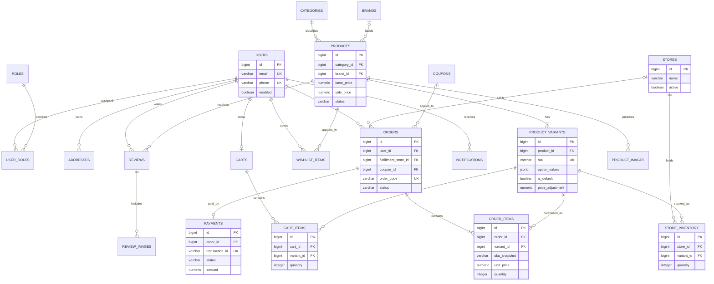

# Mô hình dữ liệu UTEGear

Tài liệu này chốt mô hình quan hệ cho PostgreSQL trước khi tạo Flyway `V1`. Mô hình dựa trên
các entity của dự án cũ, sau đó sửa những điểm không còn phù hợp với quyết định quản lý tồn kho
theo `Store + ProductVariant`.

Phạm vi DB-01 chỉ là ERD, quy tắc dữ liệu và model contract. Task này không tạo migration, entity,
repository hoặc dữ liệu mẫu.

## Quy ước chung

- Khóa chính dùng `bigint` sinh tự động.
- Thời gian lưu bằng `timestamptz`; ứng dụng trao đổi thời gian theo UTC.
- Tiền dùng `numeric(12,2)` và không dùng `double`.
- Tên bảng và cột dùng `snake_case`; tên model Java và DTO dùng `camelCase`.
- Trạng thái xóa của sản phẩm, cửa hàng và người dùng được quản lý bằng trạng thái hoạt động. Không
  xóa cứng bản ghi đã được đơn hàng tham chiếu.
- Ảnh do Cloudinary quản lý phải lưu đủ `public_id` và `secure_url`. Hai giá trị cùng có hoặc cùng
  rỗng đối với ảnh tùy chọn.
- Flyway là nguồn sự thật của schema. JPA chỉ kiểm tra schema ngoài các bài test cô lập.

## ERD

Ký hiệu `PRODUCTS ||--|{ PRODUCT_VARIANTS` thể hiện mỗi sản phẩm phải có ít nhất một biến thể.
Các bảng hỗ trợ vẫn có trong danh mục bên dưới dù ERD chỉ hiển thị các cột khóa và cột cần thiết để
đọc quan hệ.

## Danh mục bảng và ràng buộc

| Bảng | Khóa chính | Khóa ngoại | Unique và kiểm tra chính |
|---|---|---|---|
| `roles` | `id` | Không | `name`; tên role không rỗng |
| `users` | `id` | Không | `email`; `phone` khi có; `enabled` không rỗng |
| `user_roles` | `(user_id, role_id)` | `user_id -> users.id`, `role_id -> roles.id` | Khóa chính ghép ngăn gán trùng role |
| `addresses` | `id` | `user_id -> users.id` | Tối đa một địa chỉ mặc định cho mỗi user bằng partial unique index |
| `categories` | `id` | Không | `name`; `sort_order >= 0` |
| `brands` | `id` | Không | `name` |
| `products` | `id` | `category_id -> categories.id`, `brand_id -> brands.id` | `base_price >= 0`; `sale_price` rỗng hoặc nằm trong khoảng từ 0 đến `base_price` |
| `product_variants` | `id` | `product_id -> products.id` | `sku`; `(product_id, option_values)`; tối đa một biến thể mặc định cho mỗi product; `option_values` là JSON object; giá sau điều chỉnh không âm |
| `product_images` | `id` | `product_id -> products.id` | `public_id`; `(product_id, sort_order)`; tối đa một ảnh chính cho mỗi product |
| `stores` | `id` | Không | `phone` khi có; giờ mở và đóng hợp lệ; `active` không rỗng |
| `store_inventory` | `id` | `store_id -> stores.id`, `variant_id -> product_variants.id` | `(store_id, variant_id)`; `quantity >= 0` |
| `carts` | `id` | `user_id -> users.id` | `user_id`, mỗi user có tối đa một giỏ đang dùng |
| `cart_items` | `id` | `cart_id -> carts.id`, `variant_id -> product_variants.id` | `(cart_id, variant_id)`; `quantity > 0` |
| `wishlist_items` | `id` | `user_id -> users.id`, `product_id -> products.id` | `(user_id, product_id)` |
| `coupons` | `id` | Không | `code`; giá trị giảm và số lượt dùng không âm; `valid_until > valid_from` |
| `orders` | `id` | `user_id -> users.id`, `fulfillment_store_id -> stores.id`, `coupon_id -> coupons.id` | `order_code`; các số tiền không âm |
| `order_items` | `id` | `order_id -> orders.id`, `variant_id -> product_variants.id` | `(order_id, variant_id)`; `quantity > 0`; giá và thành tiền không âm |
| `payments` | `id` | `order_id -> orders.id` | `order_id`; `transaction_id` khi có; `amount >= 0` |
| `reviews` | `id` | `user_id -> users.id`, `product_id -> products.id` | `(user_id, product_id)`; `rating` từ 1 đến 5; `helpful_count >= 0` |
| `review_images` | `id` | `review_id -> reviews.id` | `public_id` |
| `notifications` | `id` | `user_id -> users.id`, có thể rỗng cho thông báo chung | Không có unique nghiệp vụ; `title` không rỗng |

Các cột nghiệp vụ còn lại được giữ theo entity cũ khi không mâu thuẫn với bảng trên. DB-02 phải tạo
DDL đầy đủ từ danh mục này và không tự thêm một nguồn tồn kho khác.

## Bất biến sản phẩm và biến thể

1. Mỗi `Product` có ít nhất một `ProductVariant` và có đúng một biến thể được đánh dấu mặc định.
2. PostgreSQL dùng partial unique index trên `product_variants(product_id) WHERE is_default` để chặn
   nhiều biến thể mặc định. Service tạo hoặc sửa sản phẩm phải bảo đảm luôn có ít nhất một biến thể
   và một biến thể mặc định trong cùng transaction.
3. Sản phẩm không có lựa chọn dùng đúng một biến thể, `is_default = true` và
   `option_values = '{}'::jsonb`. Unique index trên `(product_id, option_values)` ngăn tạo nhiều biến
   thể rỗng cho cùng product. Frontend không hiển thị bộ chọn cho trường hợp này.
4. Sản phẩm có nhiều lựa chọn lưu tổ hợp thuộc tính trong `option_values`, ví dụ
   `{"color":"black","switch":"red"}`. Mỗi biến thể vẫn có một SKU duy nhất.
5. `products` không chứa SKU hoặc số lượng tồn. SKU thuộc `product_variants`; tồn kho chỉ thuộc
   `store_inventory`.
6. Giá hiệu lực của biến thể là giá hiệu lực của product cộng `price_adjustment`. Service phải từ
   chối kết quả âm.
7. Trạng thái hết hàng là dữ liệu tính từ tổng `store_inventory.quantity`, không phải trạng thái tồn
   kho độc lập trên product.

Ràng buộc ít nhất một biến thể không thể biểu diễn an toàn bằng foreign key đơn vì product và biến
thể được tạo theo thứ tự. Backend phải tạo cả hai trong một transaction, kiểm tra trước commit và có
test cho thao tác xóa biến thể cuối cùng. DB-02 chỉ bổ sung constraint trigger nếu nhóm chấp thuận sau
khi đã có test PostgreSQL tương ứng.

## Quy tắc tồn kho, giỏ hàng và đơn hàng

- `store_inventory` là nguồn số lượng duy nhất. Mỗi cặp `store_id + variant_id` chỉ có một hàng.
- Mọi thao tác tăng, giảm hoặc điều chuyển kho phải khóa hoặc cập nhật có điều kiện để không tạo số
  lượng âm. Chi tiết cơ chế đồng thời thuộc INV-02.
- `cart_items.variant_id` bắt buộc. Giỏ hàng không lưu `product_id` riêng vì product đã được xác định
  qua biến thể.
- `order_items.variant_id` bắt buộc và không được đổi sau khi đặt hàng. Dòng đơn hàng đồng thời lưu
  snapshot gồm tên sản phẩm, SKU, thuộc tính biến thể, ảnh và giá tại thời điểm mua.
- `orders.fulfillment_store_id` có thể rỗng khi đơn vừa tạo và chưa phân bổ. Đơn nhận tại cửa hàng phải
  có giá trị này trước khi xác nhận; đơn giao tận nơi phải có trước khi trừ kho.
- `payments.order_id` là unique để một đơn chỉ có một bản ghi trạng thái thanh toán trong phạm vi hiện
  tại. Nếu sau này cần lưu nhiều lần thử thanh toán, nhóm phải mở task thay đổi contract và migration.

## Chỉ mục dự kiến cho DB-02

Ngoài các unique index, migration đầu tiên cần tạo ít nhất các index sau:

- `products(category_id, status)` và `products(brand_id, status)` cho catalog.
- `product_variants(product_id)` và GIN index cho `option_values` khi có truy vấn theo thuộc tính.
- `store_inventory(variant_id)` và `store_inventory(store_id)` cho tra cứu tồn kho hai chiều.
- `orders(user_id, created_at)`, `orders(status, created_at)` và
  `orders(fulfillment_store_id, status)` cho lịch sử và vận hành cửa hàng.
- `reviews(product_id, created_at)` cho trang chi tiết sản phẩm.
- `notifications(user_id, is_read, created_at)` cho thông báo người dùng.

DB-02 phải kiểm tra query thực tế trước khi thêm index ngoài danh sách này. Không tạo index trùng với
unique constraint hoặc primary key.

## Quy tắc xóa và lịch sử

- Có thể cascade các bảng con thuần sở hữu như `user_roles`, `addresses`, `product_images`,
  `review_images` và item trong giỏ chưa checkout.
- Không cascade xóa `orders`, `order_items` hoặc `payments` từ user, store, product hay variant.
- Product, variant và store đã tham gia giao dịch phải được vô hiệu hóa thay vì xóa cứng.
- Dữ liệu snapshot trong `order_items` là lịch sử và không được cập nhật khi catalog thay đổi.

## Đối chiếu với source cũ

| Source cũ | Quyết định DB-01 |
|---|---|
| `Product.sku` và `ProductVariant.skuVariant` cùng tồn tại | Chỉ `ProductVariant.sku` là SKU giao dịch và unique |
| `Product.stock`, `ProductVariant.stock` và `StoreInventory.stock` cùng tồn tại | Chỉ `store_inventory.quantity` là nguồn tồn kho |
| `StoreInventory.product_id` | Thay bằng `variant_id` bắt buộc |
| `ProductVariant.attributeName/attributeValue` | Thay bằng `option_values` JSONB để lưu một tổ hợp thuộc tính |
| `CartItem.product_id` và `variant_id` tùy chọn | Chỉ giữ `variant_id` bắt buộc |
| `OrderItem` chỉ tham chiếu product | Tham chiếu biến thể bắt buộc và giữ snapshot hiển thị |
| `ProductImage.url`, `ReviewImage.url` | Lưu `secure_url` cùng `public_id` cho ảnh Cloudinary |

Việc chuyển entity và dữ liệu chỉ bắt đầu ở task tương ứng sau khi tài liệu này được Backend và
Frontend duyệt.

## Checklist review DB-01

- Backend xác nhận bảng, khóa, invariant, quy tắc xóa và chỉ mục đủ để viết Flyway `V1`.
- Frontend xác nhận `optionValues`, biến thể mặc định, snapshot đơn hàng và dữ liệu tồn kho đủ cho UI.
- Không có bảng tồn kho tham chiếu trực tiếp `product_id`.
- Cart item và order item đều bắt buộc tham chiếu `variant_id`.
- Không có migration hoặc source nghiệp vụ trong PR DB-01.
