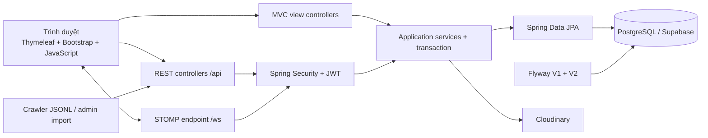

# Tổng quan kiến trúc UTEGear

UTEGear là modular monolith chạy trên Spring Boot 3.3.x và Java 21. Ứng dụng phục vụ giao diện
Thymeleaf cùng origin, REST API dưới `/api` và STOMP/WebSocket tại `/ws`. PostgreSQL trên Supabase là
nguồn dữ liệu chính; Flyway quản lý schema. Cloudinary giữ file ảnh, còn PostgreSQL chỉ lưu metadata
`secureUrl` và `publicId`.

Tài liệu này mô tả kiến trúc đã có trong source tại commit `71a50d2`. Hợp đồng chi tiết nằm trong
[`endpoint-contract.md`](../api/endpoint-contract.md), [`model-contract.md`](../api/model-contract.md)
và [`database-model.md`](database-model.md).

## Sơ đồ thành phần

## Ranh giới module

| Lớp | Vị trí | Trách nhiệm |
|---|---|---|
| Cấu hình | `config/` | Security filter chain, WebSocket broker, Cloudinary và bean dùng chung |
| Web/API | `controller/` | MVC shell, REST endpoint, validation đầu vào và HTTP status |
| DTO | `dto/` | Request/response contract; không trả trực tiếp entity JPA |
| Nghiệp vụ | `service/` | Transaction, quyền sở hữu, trạng thái đơn, tồn kho, media và realtime |
| Dữ liệu | `entity/`, `repository/` | Mapping persistence và truy vấn PostgreSQL |
| Bảo mật | `security/` | JWT, principal, user details và lỗi 401/403 thống nhất |
| Hạ tầng | `resources/db/migration/` | Schema Flyway; `V1` tạo schema, `V2` seed role |
| Giao diện | `resources/templates/`, `resources/static/` | Thymeleaf shell, Bootstrap, CSS và JavaScript gọi API |
| Nhập dữ liệu | `crawler/`, `/api/admin/products/import` | Chuẩn hóa JSONL và import catalog có kiểm soát |

Controller không chứa quy tắc nghiệp vụ dài và không đưa entity persistence trực tiếp ra API. Service
giữ transaction boundary; repository chỉ truy cập dữ liệu.

## Luồng request và phiên đăng nhập

1. MVC public render shell và dữ liệu catalog phù hợp; các trang profile, cart, order và admin tải dữ
   liệu protected từ API sau khi JavaScript đọc phiên.
2. `POST /api/auth/login` trả access token. Frontend lưu `AuthSession` trong `sessionStorage` theo tab,
   không lưu password và không đưa JWT vào URL.
3. REST protected nhận `Authorization: Bearer <token>`. API admin yêu cầu `ROLE_ADMIN`; quyền sở hữu
   cart, address, order, wishlist và notification được xác định từ JWT chứ không nhận `userId` từ client.
4. Backend stateless, không có refresh token và logout không thu hồi token ở server. Logout yêu cầu
   client xóa phiên hiện tại.

Các đường dẫn MVC được phép public để render shell; việc nhìn thấy shell không cấp quyền gọi API admin.
Chi tiết quyết định phiên nằm tại
[`auth-session-decision.md`](../frontend/auth-session-decision.md).

## Catalog, biến thể và tồn kho

- `Product` giữ thông tin chung; `ProductVariant` là đơn vị có SKU và được giao dịch.
- Mỗi product có ít nhất một variant và đúng một variant mặc định. Sản phẩm không có lựa chọn dùng một
  variant mặc định với `optionValues = {}`.
- `store_inventory` là nguồn tồn kho duy nhất theo cặp `Store + ProductVariant`.
- Cart, checkout và order dùng `variantId`; order item giữ snapshot tên, SKU, lựa chọn, ảnh và giá.
- Checkout khóa/kiểm tra tồn kho trong transaction. Hủy đơn hợp lệ hoàn số lượng về đúng store và
  variant; cập nhật đơn COD sang `COMPLETED` chuyển payment sang `PAID`.

## Media và nhập sản phẩm

Media admin yêu cầu `ADMIN`. Upload hoặc thay ảnh gửi multipart đến Backend; Backend kiểm tra file,
gọi Cloudinary và lưu đồng thời `secureUrl` cùng `publicId`. Khi replace, asset cũ chỉ bị xóa sau khi
asset mới và database đã cập nhật thành công. CI dùng mock media; QA-05 đã kiểm tra upload, replace,
render và delete với Cloudinary thật trong folder QA riêng.

Crawler là công cụ batch, không phải dịch vụ chạy liên tục. Dữ liệu sau làm sạch được xuất JSONL theo
[`data-contract.md`](../crawler/data-contract.md), rồi admin import qua multipart. Import giới hạn số
dòng và host ảnh bằng cấu hình môi trường.

## Realtime đơn hàng

- Endpoint handshake: `/ws`, không dùng SockJS.
- JWT nằm trong header `Authorization` của STOMP `CONNECT`.
- Admin được subscribe `/topic/admin/orders`.
- Customer được subscribe `/user/queue/orders` và `/user/queue/notifications`.
- Event chỉ được publish sau khi transaction database commit thành công.
- Client reconnect phải tải lại REST state trước khi áp event mới và khử trùng theo `eventId`.

`app.websocket.allowed-origins` phải là danh sách origin cụ thể; cấu hình chứa `*` hoặc danh sách rỗng
bị từ chối khi khởi động.

## Dữ liệu và migration

Flyway là nguồn sự thật của schema dùng chung. `spring.jpa.hibernate.ddl-auto=validate` chỉ đối chiếu
entity với schema, không sửa schema. Hai migration hiện có:

- `V1__create_core_schema.sql`: tạo 21 bảng, constraint và index.
- `V2__seed_reference_data.sql`: tạo hai role `ADMIN` và `CUSTOMER` theo cách idempotent.

Không sửa migration đã merge. Mọi thay đổi schema tiếp theo phải có migration version mới. Test profile
dùng H2 cô lập và tắt Flyway; PostgreSQL integration test kiểm tra riêng hành vi tương thích thật.

## Profile chạy

| Profile | Database và dịch vụ ngoài | Mục đích |
|---|---|---|
| `local` | PostgreSQL local hoặc Supabase development; Cloudinary qua cấu hình local | Phát triển và demo |
| `test` | H2 in-memory, Flyway tắt, media được mock | Unit/integration test mặc định |
| `prod` | PostgreSQL/Supabase và Cloudinary chỉ từ biến môi trường | Môi trường triển khai |

Không commit `application-local.properties`, `.env`, database URL thật, JWT secret hoặc Cloudinary key.
Hướng dẫn vận hành thuộc DOC-02 tại `docs/setup/setup-and-demo.md`.

## Giới hạn hiện tại

- Chưa có refresh token hoặc server-side token revocation.
- MVC `/forgot-password` mới là shell; chưa có API khôi phục mật khẩu.
- Coupon validation riêng, review API và admin inventory mutation đã có trong contract nhưng chưa có
  controller ở commit được tài liệu hóa. Danh sách chính xác nằm trong phần trạng thái triển khai của
  [`endpoint-contract.md`](../api/endpoint-contract.md).
- Simple broker phù hợp đồ án một instance; scale nhiều instance cần message broker dùng chung.
