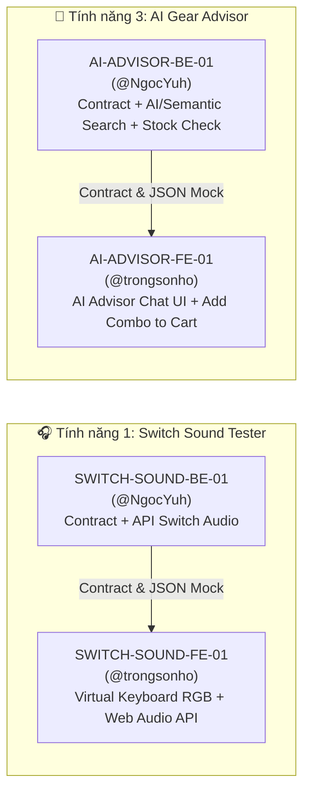

# Kế hoạch Phân công & Chi tiết Task cho 2 Tính năng Mở rộng

Ngày lập: 18/10/2026  
Tài liệu tham chiếu: [`docs/feature-ideas.md`](feature-ideas.md), [`AGENTS.md`](../AGENTS.md), [`docs/architecture/system-overview.md`](architecture/system-overview.md), [`docs/api/endpoint-contract.md`](api/endpoint-contract.md).

---

## 1. Tổng quan Lựa chọn & Phân bổ Thành viên

Nhóm thống nhất chọn **2 tính năng mở rộng** kết hợp giữa trải nghiệm tương tác đặc thù ngành Gaming Gear và ứng dụng AI gắn liền với tồn kho đa chi nhánh:

1. **Tính năng 1: 🎧 Interactive Sound Test & Virtual Switch Tester** *(Trải nghiệm gõ phím & nghe âm thanh Switch — mở rộng từ `YT-05`)*
2. **Tính năng 3: 🤖 AI Chatbot Tư vấn Cấu hình Gear & Tìm kiếm Ngữ nghĩa** *(Tư vấn bộ gear theo nhu cầu, ngân sách và tồn kho chi nhánh — mở rộng từ `YT-01`)*

### Bảng phân bổ tổng thể (Cân bằng khối lượng 50% – 50%)

Theo quy tắc trong [`AGENTS.md`](../AGENTS.md), công việc được tách bạch hoàn toàn theo vai trò **Backend (`@NgocYuh`)** và **Frontend (`@trongsonho`)**, không gộp chung sửa nghiệp vụ backend và giao diện frontend trong cùng một task/branch/PR:

| Task ID | Tính năng | Vai trò & Phụ trách | Branch dự kiến | Tỷ trọng độ khó | Task liên kết |
|---|---|---|---|---|---|
| **`SWITCH-SOUND-BE-01`** | Tính năng 1 — Switch Sound Tester (Backend) | Backend: `@NgocYuh` | `feat/switch-sound-backend` | Nhẹ (~30% TN1) | `SWITCH-SOUND-FE-01` |
| **`SWITCH-SOUND-FE-01`** | Tính năng 1 — Switch Sound Tester (Frontend) | Frontend: `@trongsonho` | `feat/switch-sound-ui` | Nặng (~70% TN1 — Chủ lực FE) | `SWITCH-SOUND-BE-01` |
| **`AI-ADVISOR-BE-01`** | Tính năng 3 — AI Gear Advisor (Backend) | Backend: `@NgocYuh` | `feat/ai-gear-advisor-backend` | Nặng (~70% TN3 — Chủ lực BE) | `AI-ADVISOR-FE-01` |
| **`AI-ADVISOR-FE-01`** | Tính năng 3 — AI Gear Advisor (Frontend) | Frontend: `@trongsonho` | `feat/ai-gear-advisor-ui` | Vừa (~30% TN3) | `AI-ADVISOR-BE-01` |



---

## 2. Nguyên tắc Bắt buộc khi Triển khai

Cả hai thành viên phải tuân thủ nghiêm ngặt các quy tắc trong [`AGENTS.md`](../AGENTS.md):

1. **Contract-First:** Backend (`@NgocYuh`) phải cập nhật `docs/api/model-contract.md`, `docs/api/endpoint-contract.md`, contract chuyên biệt và tạo JSON mẫu trong `docs/api/mock/` trước. Frontend (`@trongsonho`) có thể phát triển song song dựa trên mock data của contract mà không cần chờ endpoint thật hoàn tất.
2. **Quản lý Schema & Database:**
   - Không sửa trực tiếp các migration Flyway đã merge (`V1`, `V2`, `V3`). Nếu cần thêm bảng/cột, tạo migration mới (`V4__...`, `V5__...`).
   - Không dùng `spring.jpa.hibernate.ddl-auto=update`.
   - Tồn kho luôn kiểm tra và quản lý theo cặp `Store + ProductVariant` (`store_inventory`).
3. **Bảo mật & Media:**
   - Không commit API Key (`GEMINI_API_KEY`, Cloudinary secret, DB password...) vào repository. Mọi khóa bí mật đọc qua biến môi trường.
   - Tích hợp Cloudinary bắt buộc lưu đồng thời cả `secureUrl` và `publicId`.
   - Phân biệt rõ API `PUBLIC`, `AUTHENTICATED` và `ADMIN` (yêu cầu `ROLE_ADMIN`).
4. **Kiểm thử & Nhật ký tiến độ:**
   - Tối thiểu phải chạy `./mvnw -B clean verify` (kèm `-Dnet.bytebuddy.experimental=true` nếu dùng JDK 26 local) đạt `BUILD SUCCESS` trước khi push.
   - Cập nhật trạng thái vào đúng nhật ký vai trò: Backend tại `reports/backend/progress-log.md`, Frontend tại `reports/frontend/progress-log.md`.

---

## 3. Chi tiết Tính năng 1: 🎧 Interactive Sound Test & Virtual Switch Tester

### 3.1. Bối cảnh & Điểm nhấn Demo
- **Vấn đề thực tế:** Khi mua bàn phím cơ trực tuyến, khách hàng khó hình dung âm thanh gõ thực tế (tiếng "clicky" đanh của Blue Switch, tiếng "linear" êm của Red Switch, hay tiếng đầm của Brown Switch) và cảm giác phản hồi từng phím.
- **Giải pháp:** Cung cấp tổ hợp **Bàn phím ảo tương tác (Virtual Switch Tester)** ngay trên trang chi tiết sản phẩm bàn phím (và/hoặc khu vực trải nghiệm âm thanh switch). Khi người dùng bấm phím thật trên máy tính (`keydown`/`keyup`) hoặc chạm trên màn hình, phím ảo tương ứng phát sáng RGB và phát âm thanh mẫu qua HTML5 Web Audio API, kèm chế độ nghe đối chiếu 2 mẫu Switch (A/B).

---

### 3.2. Task Backend: `SWITCH-SOUND-BE-01` (Phụ trách: `@NgocYuh`)

- **Branch:** `feat/switch-sound-backend`
- **Task liên kết:** `SWITCH-SOUND-FE-01`
- **Nhật ký báo cáo:** `reports/backend/progress-log.md`

#### Công việc cần làm:
1. **Thiết kế Contract & Mock Data:**
   - Tạo tài liệu contract `docs/api/switch-sound-contract.md` và cập nhật mục lục trong `docs/api/endpoint-contract.md`, `docs/api/model-contract.md`.
   - Tạo file JSON mẫu `docs/api/mock/switch-sound.json` chứa danh sách mẫu switch (Red, Blue, Brown, Silver, Silent Red...) để Frontend dùng làm fixture test.
2. **Mô hình dữ liệu & Lưu trữ Audio:**
   - Chuẩn hóa thông tin mẫu âm thanh Switch (`SwitchSoundProfile` / bảng dữ liệu hoặc danh mục chuẩn hóa):
     - `id`, `code` (`RED_LINEAR`, `BLUE_CLICKY`, `BROWN_TACTILE`, `SILVER_SPEED`, `SILENT_RED`), `name`.
     - Đặc tính kỹ thuật: `switchType` (`Linear`, `Tactile`, `Clicky`), `actuationForceG` (lực nhấn, đơn vị gram), `actuationPointMm` (điểm nhận phím, mm), `totalTravelMm` (tổng hành trình, mm), `noiseLevel` (`Êm`, `Trung bình`, `Đanh/To`), `soundCharacter` (mô tả chất âm).
     - Điều kiện thu âm (`recordingCondition`): thông tin case, plate, keycap (PBT/ABS), mic và khoảng cách thu để khách hiểu giới hạn so sánh.
     - Metadata âm thanh: `audioSecureUrl` và `audioPublicId` (tuân thủ quy tắc Cloudinary lưu cả `secureUrl` và `publicId`), hỗ trợ thêm các biến thể âm thanh phím dài (`stabilizerAudioSecureUrl` / `stabilizerAudioPublicId` cho phím Space/Enter nếu có).
3. **Xây dựng REST API:**
   - `GET /api/switch-sounds` (`PUBLIC`): Trả về danh sách tất cả các profile âm thanh switch đang hoạt động, kèm điều kiện thu âm.
   - `GET /api/products/{productId}/switch-sounds` (`PUBLIC`): Trả về danh sách switch sound profile phù hợp với sản phẩm bàn phím đó (khớp theo `optionValues` của các `ProductVariant` hoặc thông số kỹ thuật của bàn phím; nếu sản phẩm có biến thể switch cụ thể thì đánh dấu `matchedVariantIds`).
   - (Tùy chọn mở rộng) `PUT /api/admin/switch-sounds/{code}/audio` (`ADMIN`): Cho phép Admin cập nhật file audio mẫu lên Cloudinary, lưu cả `secureUrl` và `publicId`.
4. **Kiểm thử Backend (`src/test/java/com/utegear/...`):**
   - Unit test cho `SwitchSoundService` và `SwitchSoundController`:
     - Trả đúng danh sách mẫu switch và điều kiện thu âm.
     - Đối khớp đúng loại switch từ `optionValues` của biến thể bàn phím.
     - Trả `404` khi `productId` không tồn tại hoặc sản phẩm ngừng bán.
     - Kiểm tra phân quyền `401`/`403` nếu có endpoint Admin.

#### Cấu trúc JSON Response mẫu (`GET /api/products/{productId}/switch-sounds`):
```json
{
  "productId": 145,
  "supported": true,
  "disclaimer": "Âm thanh thực tế có thể thay đổi tùy theo thiết bị nghe (tai nghe/loa) và kết cấu khung bàn phím.",
  "profiles": [
    {
      "code": "RED_LINEAR",
      "name": "Red Switch (Linear)",
      "switchType": "Linear",
      "actuationForceG": 45,
      "actuationPointMm": 2.0,
      "totalTravelMm": 4.0,
      "noiseLevel": "Êm",
      "soundCharacter": "Trơn mượt, không khấc, âm trầm nhẹ, phù hợp chơi game FPS và văn phòng.",
      "recordingCondition": "Case nhôm CNC, plate PC, keycap PBT Double-shot, mic condenser cách 25cm.",
      "audioSecureUrl": "https://res.cloudinary.com/demo/video/upload/v1/utegear/switches/red-linear.mp3",
      "audioPublicId": "utegear/switches/red-linear",
      "matchedVariantIds": [201]
    },
    {
      "code": "BLUE_CLICKY",
      "name": "Blue Switch (Clicky)",
      "switchType": "Clicky",
      "actuationForceG": 50,
      "actuationPointMm": 2.2,
      "totalTravelMm": 4.0,
      "noiseLevel": "Đanh / Rõ tiếng click",
      "soundCharacter": "Có khấc bấm rõ và tiếng click đanh đặc trưng, cảm giác gõ phấn khích.",
      "recordingCondition": "Case nhôm CNC, plate PC, keycap PBT Double-shot, mic condenser cách 25cm.",
      "audioSecureUrl": "https://res.cloudinary.com/demo/video/upload/v1/utegear/switches/blue-clicky.mp3",
      "audioPublicId": "utegear/switches/blue-clicky",
      "matchedVariantIds": [202]
    }
  ]
}
```

---

### 3.3. Task Frontend: `SWITCH-SOUND-FE-01` (Phụ trách: `@trongsonho`)

- **Branch:** `feat/switch-sound-ui`
- **Task liên kết:** `SWITCH-SOUND-BE-01`
- **Nhật ký báo cáo:** `reports/frontend/progress-log.md`

#### Công việc cần làm:
1. **Thiết kế Giao diện Widget `Virtual Switch Tester` (`product-detail.html` + CSS):**
   - Hiển thị khu vực **"🎧 Trải nghiệm gõ phím & Nghe thử Switch (Virtual Switch Tester)"** trên trang chi tiết sản phẩm thuộc nhóm bàn phím.
   - Bàn phím ảo trực quan gồm các cụm phím tiêu biểu (`ESC`, `1-4`, `QWER`, `ASDF`, `SHIFT`, `SPACE`, `ENTER`, cụm mũi tên) với hiệu ứng đèn nền **RGB Backlight** chuyển màu hoặc bừng sáng (ripple/glow) khi phím được kích hoạt.
   - Thanh điều khiển:
     - Chọn loại Switch muốn thử (tự động đồng bộ khi khách bấm chọn biến thể Switch ở phần mua hàng hoặc chọn tự do).
     - Nút **Bật/Tắt âm thanh (Mute/Unmute)**, thanh chỉnh âm lượng và chế độ hiệu ứng đèn RGB (`Wave`, `Reactive`, `Static`).
2. **Xử lý Âm thanh độ trễ thấp bằng HTML5 Web Audio API (`src/main/resources/static/js/domain/switch-sound.js`):**
   - Bắt sự kiện `keydown` và `keyup` khi người dùng đang focus trong vùng thử phím (hoặc bật chế độ "Bắt phím thật"), đồng thời hỗ trợ click chuột / chạm màn hình cảm ứng trên từng phím ảo.
   - Dùng `AudioContext` (hoặc fallback `HTMLAudioElement` kèm tinh chỉnh nhẹ pitch/playbackRate giữa phím thường và phím dài `Space`/`Enter`/`Backspace`) để tạo cảm giác gõ tự nhiên, liên tục nhiều phím mà không bị ngắt quãng.
   - Không tự phát âm thanh khi trang vừa tải (tuân thủ chính sách Autoplay của trình duyệt); chỉ phát khi người dùng chủ động bấm phím hoặc nút "Nghe thử".
3. **Chế độ Nghe đối chiếu 2 mẫu Switch (A/B Compare):**
   - Cho phép chọn **Mẫu A** (ví dụ: `Red Switch`) và **Mẫu B** (ví dụ: `Blue Switch`).
   - Hiển thị bảng đối chiếu trực quan: Loại switch, Lực nhấn (`g`), Điểm nhận phím (`mm`), Độ ồn, Chất âm và **Điều kiện thu âm** kèm lưu ý giới hạn thiết bị nghe.
4. **Kiểm thử Frontend & Responsive/Accessibility:**
   - Viết unit test tại `tests/frontend/switch-sound.test.mjs`: kiểm tra render danh sách switch từ mock `docs/api/mock/switch-sound.json`, chọn switch, chế độ so sánh A/B, xử lý `keydown`/`keyup`, trạng thái mute, và ẩn gọn khi sản phẩm không hỗ trợ (`supported: false`).
   - Đảm bảo không tràn ngang ở màn hình mobile `390px`, đầy đủ `aria-label`, `aria-pressed` và escape nội dung bằng `textContent`.

---

## 4. Chi tiết Tính năng 3: 🤖 AI Chatbot Tư vấn Cấu hình Gear & Tìm kiếm Ngữ nghĩa

### 4.1. Bối cảnh & Điểm nhấn Demo
- **Vấn đề thực tế:** Khách hàng mới (đặc biệt là sinh viên) thường không rành thông số kỹ thuật phức tạp (DPI, polling rate, switch profile, layout TKL/75%). Họ chỉ biết nhu cầu thực tế: *"Mình hay chơi CS2/Valorant, tay nhỏ, ngân sách dưới 1.5 triệu, muốn mua combo chuột + phím có sẵn hàng ở chi nhánh Đà Nẵng"*.
- **Giải pháp:** Xây dựng **Trợ lý AI Tư vấn Cấu hình Gear** kết hợp phân tích ngôn ngữ tự nhiên (NLP / Gemini API hoặc Semantic Scoring) với dữ liệu thực tế của UTEGear: **chỉ đề xuất sản phẩm đang bán, còn tồn kho tại đúng chi nhánh khách chọn (`Store + ProductVariant`) và tổng tiền không vượt ngân sách**, cho phép thêm cả bộ vào giỏ hàng chỉ bằng 1 cú nhấp.

---

### 4.2. Task Backend: `AI-ADVISOR-BE-01` (Phụ trách: `@NgocYuh`)

- **Branch:** `feat/ai-gear-advisor-backend`
- **Task liên kết:** `AI-ADVISOR-FE-01`
- **Nhật ký báo cáo:** `reports/backend/progress-log.md`

#### Công việc cần làm:
1. **Thiết kế Contract & Mock Data:**
   - Tạo tài liệu contract `docs/api/ai-advisor-contract.md`, cập nhật `docs/api/endpoint-contract.md` và `docs/api/model-contract.md`.
   - Tạo file JSON mẫu `docs/api/mock/ai-advisor.json` (gồm các ca: tư vấn thành công trả về 2–3 bộ combo, ca ngân sách quá thấp cần gợi ý nới ngân sách, và ca lỗi validation).
2. **Tích hợp Phân tích Ngữ cảnh AI & Semantic / Rule-based Engine:**
   - Nhận đầu vào gồm:
     - `prompt` (câu mô tả tự nhiên của khách, ví dụ: *"Tui hay chơi game FPS, tay nhỏ, ngân sách dưới 1.5 triệu, đề xuất combo chuột và phím ở chi nhánh Đà Nẵng"*).
     - Các tham số cấu trúc tùy chọn (nếu khách chọn thêm trên UI): `storeId`, `maxBudget`, `useCase` (`GAMING_FPS`, `GAMING_MOBA`, `PROGRAMMING`, `OFFICE`, `MIXED`), `categorySlugs` (`ban-phim`, `chuot`, `tai-nghe`, `phu-kien`), `preferences` (tay nhỏ, gõ êm, không dây...).
   - **Trích xuất ý định (Intent Extraction) & Tìm kiếm ngữ nghĩa:**
     - Nếu môi trường có cấu hình `GEMINI_API_KEY` (hoặc AI provider tương đương qua REST client): dùng LLM trích xuất tiêu chí từ câu chat tự nhiên và sinh lời giải thích tư vấn tự nhiên, đồng thời chấm điểm ngữ nghĩa trên tên, mô tả và `specifications.technicalSpecifications` của sản phẩm.
     - **Bắt buộc có Deterministic Fallback Engine trong Java:** Khi chạy môi trường `test`/CI hoặc khi không có `GEMINI_API_KEY` / mạng chập chờn, hệ thống tự động dùng bộ phân tích từ khóa tiếng Việt + quy tắc chấm điểm (Scoring Engine) của Java/Spring để trích xuất ngân sách, chi nhánh (TP.HCM / Hà Nội / Đà Nẵng), nhóm sản phẩm và nhu cầu. Nhờ đó, **tính năng không bao giờ bị chết khi demo mất mạng hoặc hết quota API**, và `./mvnw -B clean verify` luôn chạy độc lập 100%.
3. **Đối soát Tồn kho Chi nhánh (`Store + ProductVariant`) & Ngân sách (Rule 14):**
   - Truy vấn các biến thể `ACTIVE` của sản phẩm `ACTIVE` còn tồn kho (`quantity > 0`) tại `storeId` mục tiêu từ `StoreInventoryRepository`.
   - Tổ hợp tối đa **3 bộ Gear (Bundles)** phù hợp nhất với nhu cầu:
     - Tổng giá bán thực tế (`salePrice` nếu có khuyến mãi, ngược lại lấy `price`) của cả bộ **không được vượt `maxBudget`**.
     - Không đề xuất biến thể ngừng bán hoặc có `quantity <= 0` tại chi nhánh đã chọn.
     - Không tự suy diễn thông số kỹ thuật nếu dữ liệu sản phẩm không có; ghi rõ lý do chọn dựa trên thông số có thật.
     - Nếu không có bộ nào nằm trong ngân sách, trả danh sách combo rỗng kèm lời khuyên cụ thể (ví dụ: mức ngân sách tối thiểu cần thiết cho các món đã chọn tại chi nhánh đó).
4. **Xây dựng REST API:**
   - `POST /api/advisor/gear-recommendations` (`PUBLIC`):
     - Validate đầu vào (`prompt` không rỗng hoặc tối thiểu có tiêu chí, giới hạn độ dài `prompt <= 500` ký tự, `maxBudget > 0` nếu truyền).
     - Trả về `GearAdvisorResponse` gồm thông tin tiêu chí đã hiểu (`parsedCriteria`), lời tư vấn tổng quan (`advisorSummary`), danh sách tối đa 3 bộ (`bundles`), và các gợi ý điều chỉnh nếu không tìm được bộ phù hợp.
5. **Kiểm thử Backend (`src/test/java/com/utegear/...`):**
   - Unit test cho `GearAdvisorService` và `GearAdvisorController`:
     - Trích xuất đúng ngân sách (VD: *"1.5 triệu"*, *"2tr"*, *"800k"*), chi nhánh (CN-1, Hà Nội, Đà Nẵng) và danh mục (chuột, phím, tai nghe) từ câu tiếng Việt tự nhiên.
     - Chỉ đề xuất biến thể còn hàng (`quantity > 0`) tại đúng chi nhánh được chọn.
     - Không vượt ngân sách; trả thông báo giải thích hợp lý khi ngân sách quá thấp.
     - Hoạt động bình thường bằng Fallback Engine khi không có AI API Key.
     - Kiểm tra validation boundary (`prompt` quá dài, `maxBudget` âm, `storeId` không tồn tại).

#### Cấu trúc JSON Request & Response mẫu (`POST /api/advisor/gear-recommendations`):

**Request:**
```json
{
  "prompt": "Tui hay chơi game FPS (CS2/Valorant), tay nhỏ, ngân sách dưới 1.5 triệu, đề xuất combo chuột và phím phù hợp ở chi nhánh Đà Nẵng",
  "storeId": 3,
  "maxBudget": 1500000,
  "categorySlugs": ["chuot", "ban-phim"]
}
```

**Response (`200 OK`):**
```json
{
  "advisorMode": "HYBRID_AI",
  "parsedCriteria": {
    "storeId": 3,
    "storeName": "UTEGear Demo Đà Nẵng",
    "maxBudget": 1500000,
    "useCase": "GAMING_FPS",
    "requestedCategories": ["chuot", "ban-phim"],
    "detectedKeywords": ["fps", "valorant", "tay nhỏ"]
  },
  "advisorSummary": "Với ngân sách 1.500.000đ tại chi nhánh Đà Nẵng (CN-3) cho nhu cầu bắn FPS và form tay nhỏ, dưới đây là 2 bộ combo chuột + bàn phím đang có sẵn hàng:",
  "bundles": [
    {
      "bundleId": "BUNDLE-1",
      "title": "Bộ FPS Tối Ưu Tốc Độ & Nhỏ Gọn",
      "totalPrice": 1380000,
      "remainingBudget": 120000,
      "matchScore": 92,
      "bundleReason": "Kết hợp chuột trọng lượng nhẹ dễ vẩy tâm cho tay nhỏ và bàn phím layout gọn chừa rộng không gian di chuột.",
      "items": [
        {
          "productId": 102,
          "productName": "Chuột Gaming Logitech G102 Lightsync",
          "productSlug": "chuot-gaming-logitech-g102-lightsync",
          "categorySlug": "chuot",
          "variantId": 102,
          "sku": "G102-BLK",
          "variantLabel": "Mặc định",
          "unitPrice": 450000,
          "availableQuantity": 10,
          "imageUrl": "https://res.cloudinary.com/demo/image/upload/v1/g102.png",
          "itemReason": "Thiết kế đối xứng nhỏ gọn (85g), cảm biến 8000 DPI rất hợp tay nhỏ chơi CS2/Valorant."
        },
        {
          "productId": 145,
          "productName": "Bàn phím cơ Akko 3087 DS Midnight",
          "productSlug": "ban-phim-co-akko-3087-ds-midnight",
          "categorySlug": "ban-phim",
          "variantId": 145,
          "sku": "AKKO-3087-RED",
          "variantLabel": "Red Switch",
          "unitPrice": 930000,
          "availableQuantity": 9,
          "imageUrl": "https://res.cloudinary.com/demo/image/upload/v1/akko3087.png",
          "itemReason": "Layout TKL 87 phím gọn gàng, tốc độ phản hồi nhanh, đang còn 9 chiếc tại CN Đà Nẵng."
        }
      ]
    }
  ],
  "fallbackSuggestion": null
}
```

---

### 4.3. Task Frontend: `AI-ADVISOR-FE-01` (Phụ trách: `@trongsonho`)

- **Branch:** `feat/ai-gear-advisor-ui`
- **Task liên kết:** `AI-ADVISOR-BE-01`
- **Nhật ký báo cáo:** `reports/frontend/progress-log.md`

#### Công việc cần làm:
1. **Thiết kế Giao diện Trợ lý AI Tư vấn Gear:**
   - Tích hợp trang/panel **"🤖 AI Tư vấn Cấu hình Gear theo Chi nhánh"** (có thể truy cập từ thanh điều hướng chính / trang chủ / nút mở nhanh).
   - Khu vực nhập yêu cầu thông minh:
     - Ô nhập câu hỏi tự nhiên (ví dụ: *"Mình cần tìm combo chuột + phím chơi FPS dưới 1.5 triệu ở CN Đà Nẵng..."*).
     - Các **Chip câu hỏi mẫu (Quick Prompts)** để lúc demo перед hội đồng chỉ cần bấm 1 nút là điền sẵn tình huống mẫu ấn tượng.
     - Bộ chọn nhanh tùy chọn: Chi nhánh (`CN-1 TP.HCM`, `CN-2 Hà Nội`, `CN-3 Đà Nẵng`), Ngân sách dự kiến, và các món muốn mua (`Bàn phím`, `Chuột`, `Tai nghe`, `Phụ kiện`).
2. **Hiển thị Kết quả Tư vấn & Thao tác Giỏ hàng (`src/main/resources/static/js/domain/ai-advisor.js`):**
   - Hiển thị các thẻ tiêu chí mà AI đã bóc tách được (Chi nhánh, Ngân sách, Nhu cầu, Từ khóa).
   - Render danh sách tối đa 3 bộ Gear (`bundles`):
     - Hiển thị từng món trong bộ kèm ảnh, tên, biến thể, số lượng tồn tại chi nhánh, giá bán và **lý do AI chọn món đó**.
     - Hiển thị tổng tiền cả bộ và số tiền tiết kiệm được so với ngân sách.
   - Cho phép người dùng **bỏ chọn / đổi từng món** trong bộ và cập nhật lại tổng tiền trực tiếp.
   - Nút **"🛒 Thêm cả bộ vào giỏ hàng"**:
     - Gọi API thêm từng `variantId` đã chọn vào giỏ hàng hiện tại, cập nhật badge giỏ hàng trên header và thông báo kết quả rõ ràng (nếu chưa đăng nhập thì điều hướng đăng nhập đúng chuẩn hiện có).
   - Hiển thị gợi ý nới ngân sách (`fallbackSuggestion`) rõ ràng khi khách nhập mức ngân sách không đủ mua combo.
3. **Kiểm thử Frontend & Bảo mật Giao diện:**
   - Viết unit test tại `tests/frontend/ai-advisor.test.mjs`: kiểm tra gửi prompt, chọn quick chip, render combo từ mock `docs/api/mock/ai-advisor.json`, tính lại tổng tiền khi bật/tắt món trong bộ, thêm cả bộ vào giỏ hàng, xử lý ngân sách không đủ và chống XSS (mọi nội dung AI/sản phẩm trả về đều gán qua `textContent`).
   - Đảm bảo giao diện responsive đẹp trên cả desktop (`1440px`) và mobile (`390px`), không tràn ngang.

---

## 5. Lộ trình Phối hợp & Kịch bản Demo trước Hội đồng

### 5.1. Thứ tự thực hiện (Workflow chuẩn)
1. **Bước 1 — Chốt Contract (Backend `@NgocYuh`):**
   - Hoàn thiện contract và mock JSON cho `SWITCH-SOUND-BE-01` và `AI-ADVISOR-BE-01` để cả hai thành viên thống nhất dữ liệu đầu vào/đầu ra.
2. **Bước 2 — Phát triển Song song trên nhánh riêng:**
   - `@NgocYuh` triển khai `SWITCH-SOUND-BE-01` và `AI-ADVISOR-BE-01` (viết Unit Test, chạy `./mvnw -B clean verify`).
   - `@trongsonho` triển khai `SWITCH-SOUND-FE-01` và `AI-ADVISOR-FE-01` dựa trên contract/mock (viết Node JS Test, kiểm tra trình duyệt).
3. **Bước 3 — Mở PR, Review & Cập nhật Nhật ký tiến độ:**
   - Mỗi task đi trên 1 branch riêng và 1 Pull Request riêng, ghi nhật ký đầy đủ tại `reports/backend/progress-log.md` và `reports/frontend/progress-log.md`.

### 5.2. Kịch bản Demo "Ăn điểm" trước Hội đồng
1. **Mở đầu bằng Tính năng 3 (AI Tư vấn Gear):**
   - Đóng vai một sinh viên cần mua gear: bấm hoặc gõ câu hỏi *"Tui hay chơi game FPS (CS2/Valorant), tay nhỏ, ngân sách dưới 1.5 triệu, đề xuất combo chuột và phím phù hợp ở chi nhánh Đà Nẵng"*.
   - Hệ thống lập tức phân tích ngữ cảnh, đối soát kho thật của **CN-3 Đà Nẵng**, đề xuất các bộ combo kèm lý do chi tiết và tổng tiền nằm gọn dưới 1.5 triệu.
2. **Chuyển mượt sang Tính năng 1 (Interactive Switch Sound Tester):**
   - Từ bộ combo được AI gợi ý, bấm vào chiếc **Bàn phím cơ** để xem chi tiết.
   - Mở ngay **Virtual Switch Tester** trên trang sản phẩm: gõ trực tiếp trên bàn phím laptop trước mặt hội đồng -> màn hình phím ảo sáng đèn RGB theo từng phím gõ và phát âm thanh thực tế của **Red Switch** so với **Blue Switch** (chế độ đối chiếu A/B).
3. **Chốt đơn hoàn chỉnh:**
   - Chọn biến thể Switch ưng ý nhất sau khi nghe thử -> Thêm combo vào giỏ hàng -> Checkout tại đúng chi nhánh Đà Nẵng đã tư vấn.
